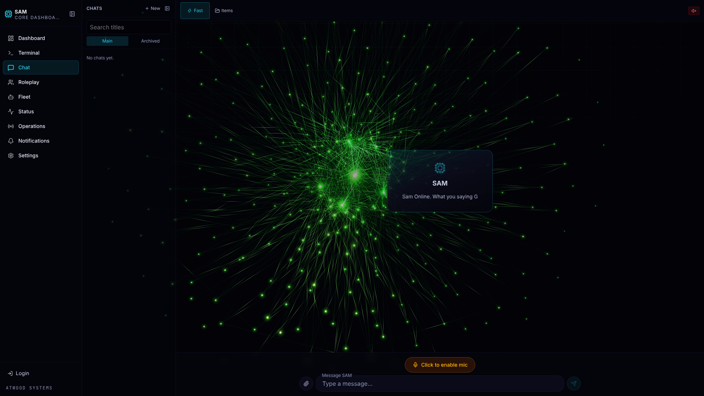
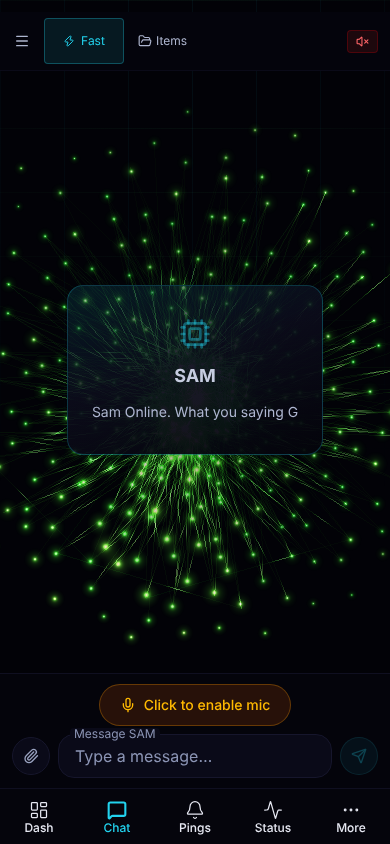

# T25 report: the welcome line on a new chat (2026-10-25)

Branch: `cloud/welcome-line-on-screen`, cut from `origin/claude/sam-core-dashboard-sf3639` at `bebf4c9`.
Ticket: T25 in `implementation/visual-upgrade-tickets.md`. Nothing deployed, no service restarted, nothing merged, no PR opened.

## Result in one line

The draft empty state now shows `Sam Online. What you saying G` where it used to show `IS EVERYWHERE`. It is visible at 1920 and at 390 with speech muted, and nothing overflows. Typecheck, lint and build exit 0. `npm test` exits 1: all 63 failures come from this cloud container, not from this change (details below).

## Diff summary

One file changed, 2 lines in, 2 lines out, all inside the `messages.length === 0` empty-state block of `src/app/(app)/chat/page.tsx`:

```diff
-            <div className="glass-strong flex flex-col items-center gap-3 rounded-2xl px-10 py-8">
+            <div className="glass-strong flex max-w-full flex-col items-center gap-3 rounded-2xl px-6 py-8 md:px-10">
               <Cpu size={32} className="text-accent/40" />
               <h2 className="text-lg font-bold text-dim-200">SAM</h2>
-              <p className="text-sm text-dim-400">IS EVERYWHERE</p>
+              <p className="break-words text-sm text-dim-300">Sam Online. What you saying G</p>
```

- **The line:** the text is exactly `Sam Online. What you saying G`. It keeps the existing card (`glass-strong`, the Cpu mark, the `SAM` heading) and the existing tokens. The text moves up one step from `dim-400` to `dim-300` (an existing token, `#aeb6d0`, already used on `/register`). It is now a real sentence rather than a dim tag, so it needs to read clearly over the visualiser.
- **Phone fit (T13 at 390):** the card's side padding is `px-6` on phone and stays `px-10` from `md` up, so desktop looks the same as before. `max-w-full` on the card and `break-words` on the line are guards that make sure a narrow screen wraps the line rather than scrolling sideways. At 390 the line fits on one line and does not need to wrap.
- **Not touched:** `src/lib/speech.ts`, `playGreeting()`, the `if (!muted) playGreeting();` call in `newConversation()` (still at `chat/page.tsx:1829`), the expired-history message above the block, and every other file.

## Browser proof

Playwright and the container's Chromium were used against `next start` running the build below. `localStorage['sam-muted']` was set to `'1'` before the page loaded, so speech was muted, and the red mute icon shows in both shots. The boot intro was tapped away before each shot.

| Width | Line box (left–right, px) | Card box (px) | `documentElement.scrollWidth` | Line overflows? | Line topmost at its centre? | Page errors | `IS EVERYWHERE` still on page? |
|---|---|---|---|---|---|---|---|
| 1920×1080 | 1097–1303 (1 line, 20px tall) | 1056–1344 | 1920 | no | yes | none | no |
| 390×844 | 92–298 (1 line, 20px tall) | 67–323 | 390 | no | yes | none | no |

Screenshots:
- `implementation/t25-screens/t25-empty-state-1920.png`
- `implementation/t25-screens/t25-empty-state-390.png`




I checked both screenshots by eye. The line is readable in both, sits under `SAM` inside the glass card, and nothing is clipped.

## Test results (raw counts)

| Command | Exit | Counts |
|---|---|---|
| `npm run typecheck` | 0 | no errors |
| `npm run lint` | 0 | 0 errors, 6 warnings (all in files this change does not touch) |
| `npm test` | **1** | tests 943 · pass 829 · fail 63 · cancelled 0 · skipped 51 · todo 0 |
| `npx next build` | 0 | compiled, all routes generated |

**Why `npm test` is red, and why it isn't T25.** The diff changes only JSX in `chat/page.tsx`, and no test imports it. The 63 failures fall into two groups:

1. **62 failures** happen in a `before` hook that checks for a user systemd bus: `systemd-run --user --scope is unavailable; <file>.test needs it.  Failed to connect to bus: No medium found`. This cloud container has no user systemd. The files affected are autoHandoff 10, chatActions 10, handoff 6, importRegistry 6, sideChannel 5, sideMessage 16 (17 hook failures, one of which is the SKIP-tagged live test) and startTurn 9.
2. **1 failure:** `.test-build/lib/server/jobs/sweepRetention.test.js` hung. It printed nothing for more than 9 minutes, and its process sat idle with no child processes. I killed that single test-file process with SIGTERM so the suite could finish and report its counts, which is why the runner shows it as `signal: 'SIGTERM'`. This is job-manager code that T25 does not touch. My guess is that something in the job manager keeps the event loop alive once systemd is missing, but I have not proved that.

On SAM's own machine, which has a user systemd, the suite is expected to run as it does on the base branch. Re-running it there is listed below.

## Raw output

### `npm run typecheck`

```

> sam-ui@0.1.0 typecheck
> tsc --noEmit

EXIT=0
```

### `npm run lint`

```

> sam-ui@0.1.0 lint
> next lint

`next lint` is deprecated and will be removed in Next.js 16.
For new projects, use create-next-app to choose your preferred linter.
For existing projects, migrate to the ESLint CLI:
npx @next/codemod@canary next-lint-to-eslint-cli .

Attention: Next.js now collects completely anonymous telemetry regarding usage.
This information is used to shape Next.js' roadmap and prioritize features.
You can learn more, including how to opt-out if you'd not like to participate in this anonymous program, by visiting the following URL:
https://nextjs.org/telemetry


./src/components/dashboard/DashboardShell.tsx
10:10  Warning: 'AvatarReceptionist' is defined but never used. Allowed unused vars must match /^_/u.  @typescript-eslint/no-unused-vars

./src/components/dashboard/widgets/MoneyInWidget.tsx
5:20  Warning: 'Plus' is defined but never used. Allowed unused vars must match /^_/u.  @typescript-eslint/no-unused-vars

./src/components/visualiser/VisualiserWidget.tsx
33:7  Warning: 'AMBER' is assigned a value but never used. Allowed unused vars must match /^_/u.  @typescript-eslint/no-unused-vars

./src/hooks/useVoiceWebSocket.ts
237:21  Warning: The ref value 'audioQueueRef.current' will likely have changed by the time this effect cleanup function runs. If this ref points to a node rendered by React, copy 'audioQueueRef.current' to a variable inside the effect, and use that variable in the cleanup function.  react-hooks/exhaustive-deps

./src/lib/server/fleetMetrics.ts
31:45  Warning: 'name' is defined but never used. Allowed unused args must match /^_/u.  @typescript-eslint/no-unused-vars

./src/lib/server/projectMetrics.ts
202:9  Warning: 'anyText' is assigned a value but never used. Allowed unused vars must match /^_/u.  @typescript-eslint/no-unused-vars

info  - Need to disable some ESLint rules? Learn more here: https://nextjs.org/docs/app/api-reference/config/eslint#disabling-rules
EXIT=0
```

### `npm test` (the full log is about 5,900 lines of TAP; included here: every `not ok` line and the final summary)

```
# failed to connect to the docker API at unix:///var/run/docker.sock; check if the path is correct and if the daemon is running: dial unix /var/run/docker.sock: connect: no such file or directory
# failed to connect to the docker API at unix:///var/run/docker.sock; check if the path is correct and if the daemon is running: dial unix /var/run/docker.sock: connect: no such file or directory
# failed to connect to the docker API at unix:///var/run/docker.sock; check if the path is correct and if the daemon is running: dial unix /var/run/docker.sock: connect: no such file or directory
# failed to connect to the docker API at unix:///var/run/docker.sock; check if the path is correct and if the daemon is running: dial unix /var/run/docker.sock: connect: no such file or directory
# failed to connect to the docker API at unix:///var/run/docker.sock; check if the path is correct and if the daemon is running: dial unix /var/run/docker.sock: connect: no such file or directory
# failed to connect to the docker API at unix:///var/run/docker.sock; check if the path is correct and if the daemon is running: dial unix /var/run/docker.sock: connect: no such file or directory
# failed to connect to the docker API at unix:///var/run/docker.sock; check if the path is correct and if the daemon is running: dial unix /var/run/docker.sock: connect: no such file or directory
# failed to connect to the docker API at unix:///var/run/docker.sock; check if the path is correct and if the daemon is running: dial unix /var/run/docker.sock: connect: no such file or directory
# failed to connect to the docker API at unix:///var/run/docker.sock; check if the path is correct and if the daemon is running: dial unix /var/run/docker.sock: connect: no such file or directory
# failed to connect to the docker API at unix:///var/run/docker.sock; check if the path is correct and if the daemon is running: dial unix /var/run/docker.sock: connect: no such file or directory
# failed to connect to the docker API at unix:///var/run/docker.sock; check if the path is correct and if the daemon is running: dial unix /var/run/docker.sock: connect: no such file or directory
# failed to connect to the docker API at unix:///var/run/docker.sock; check if the path is correct and if the daemon is running: dial unix /var/run/docker.sock: connect: no such file or directory
# failed to connect to the docker API at unix:///var/run/docker.sock; check if the path is correct and if the daemon is running: dial unix /var/run/docker.sock: connect: no such file or directory
# failed to connect to the docker API at unix:///var/run/docker.sock; check if the path is correct and if the daemon is running: dial unix /var/run/docker.sock: connect: no such file or directory
# failed to connect to the docker API at unix:///var/run/docker.sock; check if the path is correct and if the daemon is running: dial unix /var/run/docker.sock: connect: no such file or directory
not ok 418 - check 11: a Max chat at 410k hands off at turn start and carries the message (and file) into the new chat
not ok 419 - check 11: a Max 2 chat at 410k hands off onto Max 2
not ok 420 - check 11: a chat at 390k runs a normal turn
not ok 421 - an internal turn, and a caller that did not opt in (the dashboard widget), never trigger it
not ok 422 - check 11: a running turn is never interrupted; the check is only at turn start
not ok 423 - a chat already handed off runs a normal turn
not ok 424 - if the handoff cannot start, the message still runs as a normal turn on the old chat
not ok 425 - a manual handoff still starts the child with the memo pointer alone
not ok 426 - a carried message already at the length cap still fits in the new chat
not ok 427 - an automatic handoff whose memo is not written sets handoffError and starts nothing
not ok 428 - check 3: a chat read back after its turn finishes is identical for two callers, and holds the turn
not ok 429 - check 8: archive hides, restore returns, delete removes from both lists and 404s openChat, transcript stays
not ok 430 - delete drops the chat's side-message records, and only that chat's
not ok 431 - check 8: archive and delete are refused with 409 while the turn is running
not ok 432 - check 7a: ?q= filters the main list and Archived by title only
not ok 433 - finding 3: a runningJobId left over from a restart (no lock held) does not hide the last exchange or hand back a dead job id
not ok 434 - finding 7: reattaching before the new turn's prompt is even on disk does not hide the previous finished turn
not ok 435 - finding 7: once the new turn's prompt is actually on disk, reattach hides that turn and still returns its prompt text
not ok 436 - finding 7 + T8a: a late side message answered by the running job hides the whole in-flight turn, not just its last pair
not ok 437 - adopt: refuses an unknown id, adopts a pre-upgrade chat unarchived, and stays idempotent
# failed to connect to the docker API at unix:///var/run/docker.sock; check if the path is correct and if the daemon is running: dial unix /var/run/docker.sock: connect: no such file or directory
# failed to connect to the docker API at unix:///var/run/docker.sock; check if the path is correct and if the daemon is running: dial unix /var/run/docker.sock: connect: no such file or directory
# failed to connect to the docker API at unix:///var/run/docker.sock; check if the path is correct and if the daemon is running: dial unix /var/run/docker.sock: connect: no such file or directory
# failed to connect to the docker API at unix:///var/run/docker.sock; check if the path is correct and if the daemon is running: dial unix /var/run/docker.sock: connect: no such file or directory
# failed to connect to the docker API at unix:///var/run/docker.sock; check if the path is correct and if the daemon is running: dial unix /var/run/docker.sock: connect: no such file or directory
# failed to connect to the docker API at unix:///var/run/docker.sock; check if the path is correct and if the daemon is running: dial unix /var/run/docker.sock: connect: no such file or directory
not ok 465 - check 7b: handoff to max2 writes one memo and opens a linked chat on max2
not ok 466 - finding 6: a new handoff clears the PREVIOUS attempt's handoffError and handedOffTo before its own chain finishes
not ok 467 - handoff is refused with 409 while a turn runs, and 404 for unknown or deleted chats
not ok 468 - a memo turn that writes no memo sets handoffError and starts nothing
not ok 469 - handoffChildTitle: the parent name plus one (handoff), never two
not ok 470 - a handoff child is named after its parent, and the titler leaves that name alone
not ok 471 - import: exactly the 3 ids with a transcript land in Archived, none in the main list
not ok 472 - import: tiers and accounts are inferred correctly
not ok 473 - adopt: adopting one imported chat puts it alone in the main list
not ok 474 - restore + startTurn on the mixed (unknown-tier, main-account) chat resumes with no CLAUDE_CONFIG_DIR
not ok 475 - restore + startTurn on the Max 2 chat resumes with CLAUDE_CONFIG_DIR set to the Max 2 dir
not ok 476 - a second import adds nothing
not ok 477 - isResultLine: a real-CLI-shaped result line (type not first) is a result
not ok 478 - isResultLine: a type-first result line (the fake's old shape) is still a result
not ok 479 - isResultLine: an assistant line whose text merely contains the string "type":"result" is not a result
not ok 480 - isResultLine: a non-JSON line is not a result
not ok 481 - check 3: a side message sent mid-turn is written to stdin exactly once, unchanged
not ok 482 - check 7: a side message arriving after the first result gets its own second result
not ok 483 - check 12: two devices' side messages land in the order the server received the calls
not ok 484 - check 6 / check 9 (with side message): a dead stdin handle fails the side message but never touches the real turn
not ok 485 - T8 end-to-end: a mid-turn side message survives into readHistory as a side block after the turn exits
not ok 486 - review 3: a handoff memo turn takes no side message (409), and nothing reaches its stdin
not ok 487 - review 3: any server-started (internal) turn takes no side message, even with no pending handoff
not ok 488 - review 8: a side message over the normal message cap is refused with 400 and never reaches the turn
not ok 489 - review 4: a stderr fragment without a newline just before the result line still closes stdin and ends the turn
not ok 490 - review 6: a late side message is already tagged when the chat stops being "running" and the lock is released
not ok 491 - cleanup: a turn stopped before its result leaves nothing behind in the close-timer bookkeeping
not ok 492 - a non-Max chat refuses a side message with 400
not ok 493 - check 2 (live): a side message sent 8s into a 25s tool call reaches the same turn's answer # SKIP set SAM_LIVE_SIDE_MESSAGE=1 to spend one real Haiku call
not ok 494 - check 4: two new chats started together both finish with their own replies
not ok 495 - a second turn on a running chat returns 409; the next turn resumes it
not ok 496 - check 7: a turn on a different tier after the first message returns 409
not ok 497 - a Max 2 chat runs with CLAUDE_CONFIG_DIR set to the Max 2 dir
not ok 498 - unknown and deleted chat ids get 404 and never spawn
not ok 499 - a pre-upgrade chat (registry id + transcript, no record) is adopted and resumed
not ok 500 - T4: a Max turn argv carries --input-format and no bare prompt; a Fast turn keeps today's argv byte-for-byte
not ok 501 - check 9 (no side message): a finished Max turn leaves no process and no cgroup behind
not ok 502 - check 10/11 regression: a second turn on a running Max chat is still refused while the first is in flight
# failed to connect to the docker API at unix:///var/run/docker.sock; check if the path is correct and if the daemon is running: dial unix /var/run/docker.sock: connect: no such file or directory
# failed to connect to the docker API at unix:///var/run/docker.sock; check if the path is correct and if the daemon is running: dial unix /var/run/docker.sock: connect: no such file or directory
# failed to connect to the docker API at unix:///var/run/docker.sock; check if the path is correct and if the daemon is running: dial unix /var/run/docker.sock: connect: no such file or directory
# failed to connect to the docker API at unix:///var/run/docker.sock; check if the path is correct and if the daemon is running: dial unix /var/run/docker.sock: connect: no such file or directory
# failed to connect to the docker API at unix:///var/run/docker.sock; check if the path is correct and if the daemon is running: dial unix /var/run/docker.sock: connect: no such file or directory
# failed to connect to the docker API at unix:///var/run/docker.sock; check if the path is correct and if the daemon is running: dial unix /var/run/docker.sock: connect: no such file or directory
not ok 687 - a write raced against the child already exiting never crashes the process (EPIPE safety)
not ok 688 - deliverSideMessage preserves call order; closeStdin ends the child; delivery fails after exit
not ok 689 - review 4: onOutputChunk sees stdout chunks only, never stderr
not ok 690 - review 5: a marker delivered mid-line waits for the line to finish, then follows it
not ok 691 - review 5: a marker still waiting when the job ends is written on a line of its own
not ok 111 - .test-build/lib/server/jobs/sweepRetention.test.js
# failed to connect to the docker API at unix:///var/run/docker.sock; check if the path is correct and if the daemon is running: dial unix /var/run/docker.sock: connect: no such file or directory
# failed to connect to the docker API at unix:///var/run/docker.sock; check if the path is correct and if the daemon is running: dial unix /var/run/docker.sock: connect: no such file or directory
# failed to connect to the docker API at unix:///var/run/docker.sock; check if the path is correct and if the daemon is running: dial unix /var/run/docker.sock: connect: no such file or directory
# failed to connect to the docker API at unix:///var/run/docker.sock; check if the path is correct and if the daemon is running: dial unix /var/run/docker.sock: connect: no such file or directory
# failed to connect to the docker API at unix:///var/run/docker.sock; check if the path is correct and if the daemon is running: dial unix /var/run/docker.sock: connect: no such file or directory
# failed to connect to the docker API at unix:///var/run/docker.sock; check if the path is correct and if the daemon is running: dial unix /var/run/docker.sock: connect: no such file or directory
# tests 943
# suites 8
# pass 829
# fail 63
# cancelled 0
# skipped 51
# todo 0
# duration_ms 596486.480427
EXIT=1
```

### `npx next build`

```
   ▲ Next.js 15.5.25
   - Experiments (use with caution):
     · optimizePackageImports

   Creating an optimized production build ...
 ✓ (serwist) Bundling the service worker script with the URL '/sw.js' and the scope '/'...
 ✓ Compiled successfully in 46s
   Linting and checking validity of types ...

./src/components/dashboard/DashboardShell.tsx
10:10  Warning: 'AvatarReceptionist' is defined but never used. Allowed unused vars must match /^_/u.  @typescript-eslint/no-unused-vars

./src/components/dashboard/widgets/MoneyInWidget.tsx
5:20  Warning: 'Plus' is defined but never used. Allowed unused vars must match /^_/u.  @typescript-eslint/no-unused-vars

./src/components/visualiser/VisualiserWidget.tsx
33:7  Warning: 'AMBER' is assigned a value but never used. Allowed unused vars must match /^_/u.  @typescript-eslint/no-unused-vars

./src/hooks/useVoiceWebSocket.ts
237:21  Warning: The ref value 'audioQueueRef.current' will likely have changed by the time this effect cleanup function runs. If this ref points to a node rendered by React, copy 'audioQueueRef.current' to a variable inside the effect, and use that variable in the cleanup function.  react-hooks/exhaustive-deps

./src/lib/server/fleetMetrics.ts
31:45  Warning: 'name' is defined but never used. Allowed unused args must match /^_/u.  @typescript-eslint/no-unused-vars

./src/lib/server/projectMetrics.ts
202:9  Warning: 'anyText' is assigned a value but never used. Allowed unused vars must match /^_/u.  @typescript-eslint/no-unused-vars

info  - Need to disable some ESLint rules? Learn more here: https://nextjs.org/docs/app/api-reference/config/eslint#disabling-rules
   Collecting page data ...
   Generating static pages (0/8) ...
   Generating static pages (2/8) 
   Generating static pages (4/8) 
   Generating static pages (6/8) 
 ✓ Generating static pages (8/8)
   Finalizing page optimization ...
   Collecting build traces ...

Route (app)                                 Size  First Load JS
┌ ƒ /                                    37.2 kB         275 kB
├ ○ /_not-found                             1 kB         106 kB
├ ƒ /api/auth/authenticate/options         274 B         105 kB
├ ƒ /api/auth/authenticate/verify          274 B         105 kB
├ ƒ /api/auth/devices                      274 B         105 kB
├ ƒ /api/auth/register/options             274 B         105 kB
├ ƒ /api/auth/register/verify              274 B         105 kB
├ ƒ /api/auth/session                      274 B         105 kB
├ ƒ /api/auth/stepup                       274 B         105 kB
├ ƒ /api/avatar/session                    274 B         105 kB
├ ƒ /api/avatar/tts                        274 B         105 kB
├ ƒ /api/build                             274 B         105 kB
├ ƒ /api/chat/agent                        274 B         105 kB
├ ƒ /api/chat/tts                          274 B         105 kB
├ ƒ /api/chats                             274 B         105 kB
├ ƒ /api/chats/[id]                        274 B         105 kB
├ ƒ /api/chats/[id]/handoff                274 B         105 kB
├ ƒ /api/chats/[id]/side                   274 B         105 kB
├ ƒ /api/chats/adopt                       274 B         105 kB
├ ƒ /api/chats/focus                       274 B         105 kB
├ ƒ /api/dashboard/layout                  274 B         105 kB
├ ƒ /api/dashboard/money                   274 B         105 kB
├ ƒ /api/dashboard/projects                274 B         105 kB
├ ƒ /api/dashboard/system                  274 B         105 kB
├ ƒ /api/dashboard/tasks                   274 B         105 kB
├ ƒ /api/dashboard/usage                   274 B         105 kB
├ ƒ /api/fleet/dispatch                    274 B         105 kB
├ ƒ /api/fleet/finished-jobs               274 B         105 kB
├ ƒ /api/fleet/floor                       274 B         105 kB
├ ƒ /api/fleet/job-tickets                 274 B         105 kB
├ ƒ /api/fleet/jobs                        274 B         105 kB
├ ƒ /api/fleet/registry                    274 B         105 kB
├ ƒ /api/fleet/runs                        274 B         105 kB
├ ƒ /api/fleet/schedule                    274 B         105 kB
├ ƒ /api/fleet/spend                       274 B         105 kB
├ ƒ /api/health                            274 B         105 kB
├ ƒ /api/jobs                              274 B         105 kB
├ ƒ /api/jobs/[id]                         274 B         105 kB
├ ƒ /api/jobs/[id]/input                   274 B         105 kB
├ ƒ /api/jobs/[id]/stream                  274 B         105 kB
├ ƒ /api/notifications                     274 B         105 kB
├ ƒ /api/omni/desktop                      274 B         105 kB
├ ƒ /api/omni/email                        274 B         105 kB
├ ƒ /api/operations                        274 B         105 kB
├ ƒ /api/operations/[id]/variables         274 B         105 kB
├ ƒ /api/operations/dispatch               274 B         105 kB
├ ƒ /api/os                                274 B         105 kB
├ ƒ /api/practice/briefs                   274 B         105 kB
├ ƒ /api/practice/turn                     274 B         105 kB
├ ƒ /api/push                              274 B         105 kB
├ ƒ /api/questions                         274 B         105 kB
├ ƒ /api/questions/answer                  274 B         105 kB
├ ƒ /api/status                            274 B         105 kB
├ ƒ /api/uploads                           274 B         105 kB
├ ƒ /api/vault/contacts                    274 B         105 kB
├ ƒ /api/vault/file                        274 B         105 kB
├ ƒ /api/vault/graph                       274 B         105 kB
├ ƒ /api/vault/meta                        274 B         105 kB
├ ƒ /api/vault/recent                      274 B         105 kB
├ ƒ /api/voice/transcribe                  274 B         105 kB
├ ƒ /chat                                  25 kB         213 kB
├ ƒ /classic                             7.54 kB         208 kB
├ ƒ /fleet                               6.35 kB         186 kB
├ ƒ /fleet/[persona]                     3.09 kB         179 kB
├ ○ /intro                               1.91 kB         387 kB
├ ƒ /jobs                                  139 B         131 kB
├ ƒ /jobs/[id]                             139 B         131 kB
├ ƒ /notifications                       6.05 kB         123 kB
├ ○ /offline                               167 B         109 kB
├ ƒ /operations                           6.6 kB         184 kB
├ ƒ /practice                            5.77 kB         131 kB
├ ƒ /register                            2.33 kB         110 kB
├ ƒ /render/icon                         1.74 kB         379 kB
├ ƒ /settings                            6.03 kB         144 kB
├ ƒ /status                              8.04 kB         122 kB
└ ƒ /terminal                              139 B         131 kB
+ First Load JS shared by all             105 kB
  ├ chunks/2804-d066e146d8d7e6c9.js      47.5 kB
  ├ chunks/4bd1b696-100b9d70ed4e49c1.js  54.2 kB
  └ other shared chunks (total)          3.33 kB


○  (Static)   prerendered as static content
ƒ  (Dynamic)  server-rendered on demand

EXIT=0
```

## For SAM to check

1. Open a new chat on the phone (390) and the desktop with the voice **muted**. The card should read `SAM` / `Sam Online. What you saying G` and the page should not scroll sideways.
2. Open a new chat with the voice **unmuted**. The greeting mp3 should still play once, exactly as before, because `playGreeting()` and its call were not touched. The cloud browser test only ran muted.
3. Look at whether `dim-300` is the right weight for the line over the visualiser on the real screen, or whether it should go back to `dim-400`. Changing it is a one-token edit.
4. Run `npm test` on SAM's own machine, which has a user systemd. Confirm the 62 systemd-hook tests pass there and that `sweepRetention.test` finishes rather than hanging. If it hangs there too, that is a separate issue from T25.
